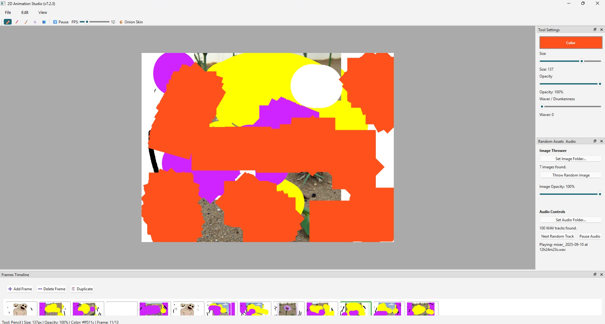

# Spiral Animator (المحرك اللولبي)

Spiral Animator is an experimental 2D animation and drawing tool for desktop. It's designed for creating frame-by-frame animations with added features for generative art.



## Features

- **2D Animation:** A full frame-by-frame animation timeline with onion skinning.
- **Drawing Tools:** Pencil, Brush, Eraser, Spray Paint, and a fast Flood Fill with adjustable tolerance (no halos around soft brush edges).
- **Generative Drawing:** Use the "Waver / Drunkenness" slider to add randomness to your brush strokes.
- **Image Thrower:** Load a folder of images and "throw" them onto your canvas for a collage effect.
- **Audio Playback:** Load a folder of `.wav`, `.mp3`, `.ogg` or `.flac` files. The app picks random tracks from the folder to help you animate to music.
- **Live A/V Recording:** Record your animation as you draw to an MP4 or GIF. MP4 recordings include the music that was playing, in sync.
- **Timeline Export:** Export your finished animation timeline to MP4, GIF (looping), or a PNG image sequence.
- **Project Files:** Save your work as a `.spiral` project and open it again later.
- **Undo / Redo:** Works across frames, including adding, duplicating and deleting frames and resizing the canvas.

## Installation

This application is built with Python and PyQt6.

```bash
# Clone this repository
git clone https://github.com/mahmoudismail91/Spiral-Animator-.git
cd Spiral-Animator-

# Install the required libraries
pip install -r requirements.txt
```

The requirements are PyQt6, imageio, numpy, scipy, pygame and imageio-ffmpeg. `imageio-ffmpeg` comes with its own copy of ffmpeg, so you don't need to install ffmpeg separately.

## Usage

```bash
python spiral_animator.py

# or open a saved project directly
python spiral_animator.py my_animation.spiral
```

- Use the drawing tools (Brush, Pencil, Fill, etc.) to draw on the canvas.
- Click "➕ Add Frame" to add a new frame to your animation.
- Click "▶️ Play" to loop your animation. You can keep drawing while it plays.
- Drag the edges of the white canvas to resize it.
- Load a Random Image Folder or Audio Folder in the "Random Assets & Audio" dock to add generative elements.
- Use File > Save Project to keep your work, and File > Export As to make videos, GIFs or PNGs.

### Keyboard shortcuts

| Key | Action |
| --- | --- |
| P / B / E / S / F | Pencil / Brush / Eraser / Spray / Fill |
| Space (hold) | Pan the canvas |
| Ctrl + mouse wheel | Zoom |
| Ctrl+0 | Reset view |
| Ctrl+N / Ctrl+O | New animation / Open project |
| Ctrl+S / Ctrl+Shift+S | Save project / Save project as |
| Ctrl+Z / Ctrl+Y | Undo / Redo |
| Ctrl+D | Duplicate frame |
| Delete | Clear frame |

## Project file format

A `.spiral` file is a zip archive containing `project.json` (canvas size, FPS, frame count) and one transparent PNG per frame in `frames/`. You can unzip it to get at the raw frames.

## License

This project is licensed under the MIT License. (See LICENSE file).

## Acknowledgements

Creator: Mahmoud Ismail (Al Hut الحوت)
